# Changelog

Downloads and install notes are on the
[Releases](https://github.com/ReaMesh/ReaMesh/releases) page.

## 1.2.0

November 5, 2026

<picture>
  <source media="(prefers-color-scheme: dark)" srcset="proprietary/changelog/1.2.0-banner-dark.png">
  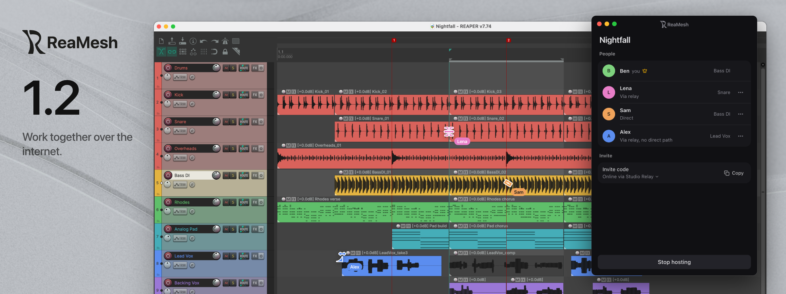
</picture>

Everyone in a session needs ReaMesh 1.2. It can't join sessions hosted with 1.1,
and 1.1 can't join sessions hosted with 1.2. The Lobby greys out sessions from
another version and says who has to update.

### Work together over the internet

Until now, computers had to reach each other over a local network or a VPN. They
can now also connect across the internet through a relay: a small server you run
yourself, for your band, studio or circle of collaborators. There is no public
relay and no account.

Paste the relay's code in Settings → Relay. While you host, your invite code also
names the relay, so guests set nothing up. Computers connect directly whenever
their routers allow it and use the relay only when that fails. The people list
shows how each person is connected. The relay forwards encrypted traffic it can't
read, and a session reachable through a relay always has a secret: its password,
or for an open session a random secret inside the invite code.

<picture>
  <source media="(prefers-color-scheme: dark)" srcset="proprietary/changelog/1.2.0-relay-dark.png">
  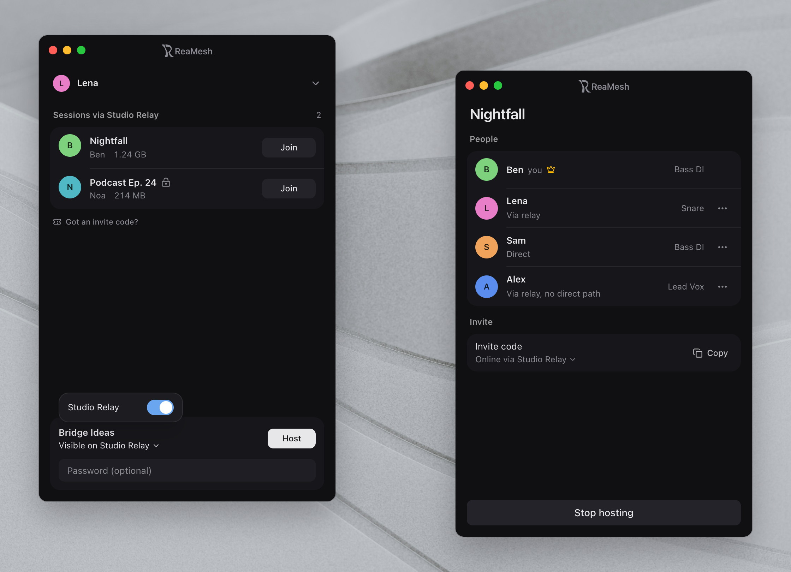
</picture>

A relay can also keep a session list, if its operator turns that on. Everyone with
a key then sees in the Lobby what the others host through it and joins with one
click. As a host you choose per relay whether your session shows up there.

### Run your own relay

The relay ships with this release for the first time: static builds for Linux on
x86_64 and aarch64, and a Docker image. On its first start it prints the relay code
to hand out. [The relay's README](https://github.com/ReaMesh/ReaMesh/tree/main/relay)
covers setup, including a small VPS or a Raspberry Pi at home.

<picture>
  <source media="(prefers-color-scheme: dark)" srcset="proprietary/changelog/1.2.0-relay-server-dark.png">
  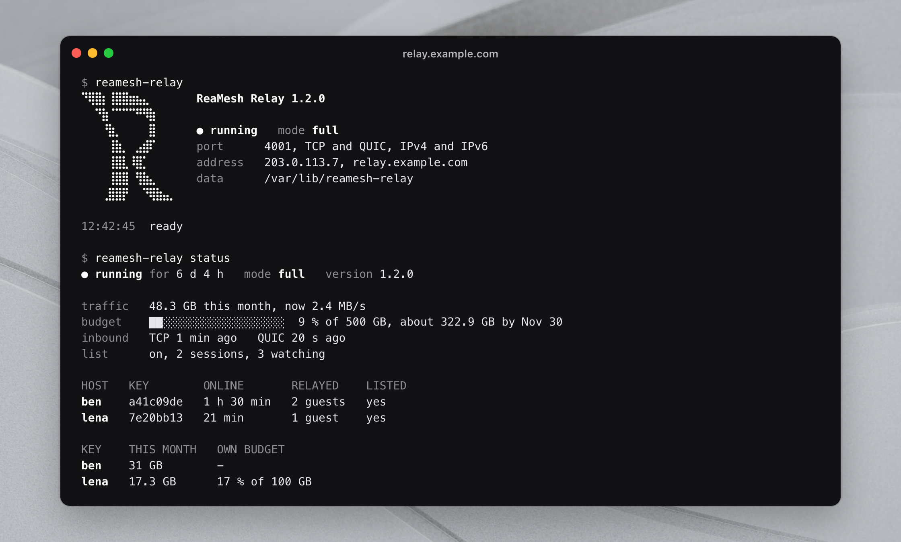
</picture>

- `reamesh-relay status` shows the traffic, the budget and who is online.
- Each person can get their own key, with a last day, a limit on hosts and a monthly
  budget. Removing a key takes that person's access away within seconds.
- `notice set` sends a message to everyone using the relay, shown in the app.
- A running relay updates itself. It checks the signature of a new version and
  restarts into it only while nothing is being relayed.

### See what the others are doing

A person's cursor in the arrange view now takes the shape of the tool they are using:
trimming an item edge, dragging a fade, adjusting a crossfade, slip editing or
making a razor edit. The shapes morph into each other as they move.

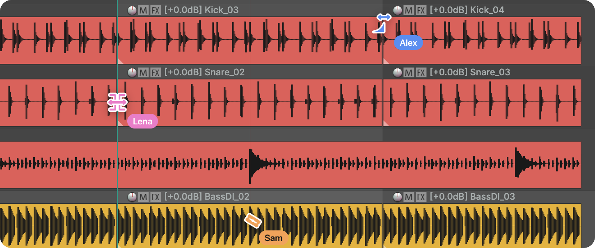

### Keep your copy

When a session ends, your copy of the project is saved with everything you worked on.
The Lobby shows the last session with a way back in, and you can save the copy to a
folder of your choice. Settings → Joined projects shows how many days each copy has
left and lets you keep one for good.

<picture>
  <source media="(prefers-color-scheme: dark)" srcset="proprietary/changelog/1.2.0-copies-dark.png">
  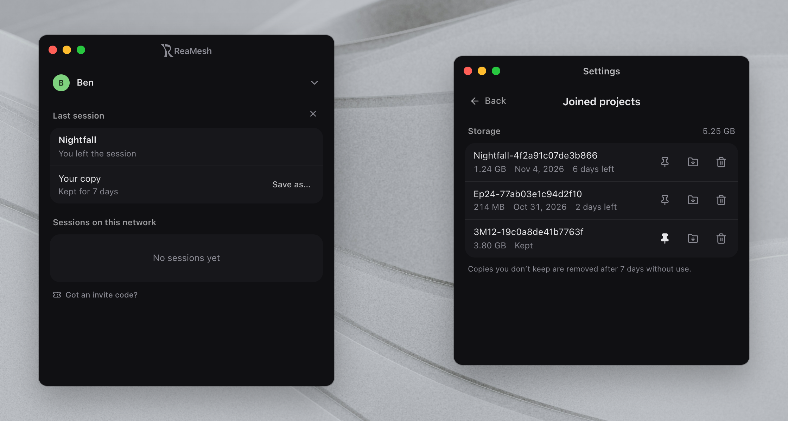
</picture>

A saved or kept copy stays linked to its project. Joining that project again updates
the copy in its own folder and keeps the project file it replaces. If you changed the
copy yourself, ReaMesh asks first. After a save as, an open tab moves over to the new
folder when that is safe.

### Other changes

- In the floating people list, one click on the eye follows a person, and Ping sends
  right away. Pings appear below the list, and the notice that someone is editing
  also shows when the list is collapsed.
- The people lists show a track's name. A new setting switches back to numbers only.
- When a session ends on its own, the floating list stays up and says why.
- Items whose media never arrived are reported in the floating list, with a retry.
- The Lobby shows each session's project size, and the password field opens when you
  click Join. An empty list offers the Bluetooth search.
- An untitled project can be saved and hosted in one click.
- A join that won't fit on the disk is refused before it starts.
- A new hosting run shows up in the Lobby at once.
- Hosting and joining no longer fail on an iPhone hotspot on macOS.
- Tooltips, buttons, dialogs and screen changes have new, calmer animations, and
  Settings keeps its scroll position.
- On Windows, the window can no longer be maximized.

### Security

- Lobby announcements stay on the local network and never cross a relay.
- The number of connections is limited in total, per person and per address.
- Opening a relay link only asks whether to add it. Nothing is contacted before you
  agree.
- Resetting your network identity now asks first, since others stop recognizing you.
- Dependencies were updated past known security advisories.

### Good to know

Relays built from source before this release don't update themselves. Install this
version once, and they keep themselves up to date from then on.

## 1.1.0

October 21, 2026

<picture>
  <source media="(prefers-color-scheme: dark)" srcset="proprietary/changelog/1.1.0-banner-dark.png">
  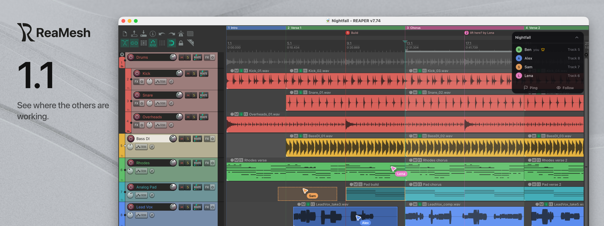
</picture>

Everyone in a session needs ReaMesh 1.1. It can't join sessions hosted with 1.0,
and 1.0 can't join sessions hosted with 1.1. The Lobby greys out sessions from
another version and says who has to update.

### See where the others are working

You now see the other people's mouse pointers inside REAPER's arrange view, with
their name and color. A pointer fades out when its owner switches to an FX
window, the mixer or the MIDI editor, and comes back when they return to the
arrange.

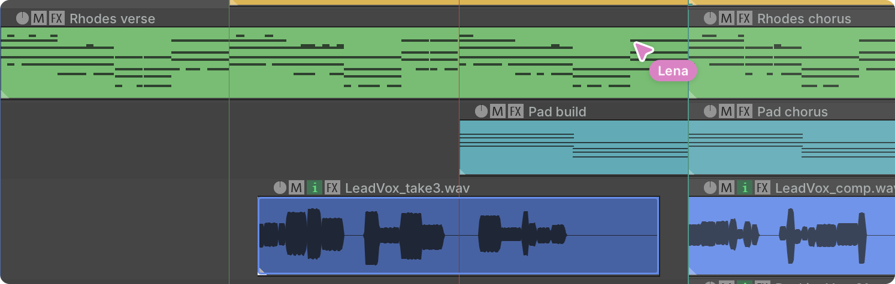

Items someone else is editing are dimmed and outlined in that person's color.
When someone drags items, you see a dashed outline of where they will land.
Volume, pan, width and the plug-in parameter someone is turning update live while
they hold the mouse button, not only after they let go.

If you follow someone, their pointer is highlighted and your view keeps up with
the items they drag. If you edit an item that someone else is already working on,
your change snaps back right away.

<picture>
  <source media="(prefers-color-scheme: dark)" srcset="proprietary/changelog/1.1.0-editing-outline-dark.png">
  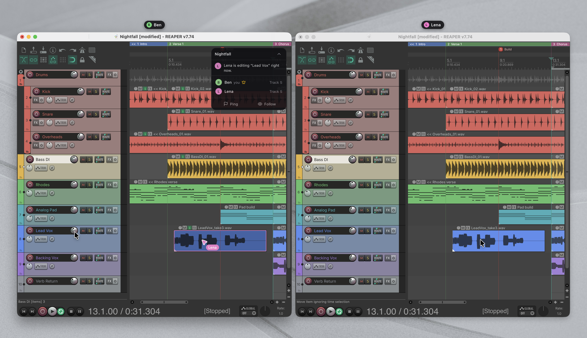
</picture>

Two new settings let you hide the others' pointers or stop sharing your own.

### Find sessions over Bluetooth

Some networks, guest Wi-Fi for example, block the discovery ReaMesh uses to list
sessions in the Lobby. The app can now use Bluetooth to find hosts nearby, on
macOS and Windows. It stays off until you turn it on: the Lobby asks once, and the
switch is in Settings. Bluetooth only carries the host's network address. The
session itself still runs over the network, so both computers need to reach each
other there.

### Other changes

- Marker and region ruler lanes are synced on REAPER 7.19 and later.
- Edits in large projects go out faster, and big updates are compressed.
- Settings has a new Joined projects list with the copies of projects you joined,
  their size and when you last used them. You can open a copy's folder or move it
  to the Trash (Recycle Bin on Windows). Unused copies are now kept for 7 days
  instead of 3.
- On macOS, Settings opens in its own window and has the same options as on
  Windows.
- Guests who can only reach each other through the host, for example after joining
  by invite link, now see each other in the session.
- Hosting again no longer leaves an old second entry in other people's Lobby.
- On first setup the extension is installed when you click Install, so the setup
  screen can tell you to restart REAPER.

### Security

- When a session has a passphrase, the host now has to prove it knows the
  passphrase before you download anything. A copied session with the same name can
  no longer pick up a working key from people who type the passphrase into it.
- The connection between the app and REAPER needs a key that changes every time
  REAPER starts, so other programs on your computer can't control ReaMesh.
- Invite links ignore local-only addresses and wait until you click Join.
- Incoming changes are checked before they reach REAPER, and media paths that
  point outside the project folder are refused.

### Good to know

On macOS, the system may ask for Bluetooth permission again after this update.

**Full changelog**: [v1.0.0...v1.1.0](https://github.com/ReaMesh/ReaMesh/compare/v1.0.0...v1.1.0)

## 1.0.0

October 15, 2026

<picture>
  <source media="(prefers-color-scheme: dark)" srcset="proprietary/changelog/1.0.0-banner-dark.png">
  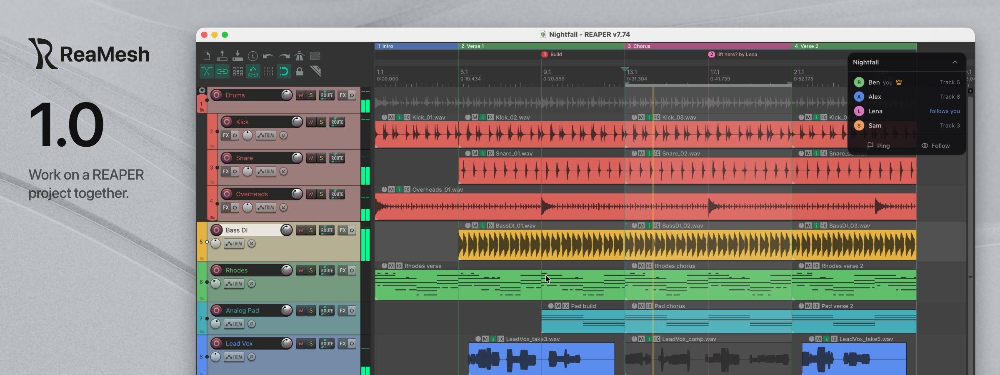
</picture>

The first release. ReaMesh lets several people work on one REAPER project at the
same time, each in their own REAPER, on macOS and Windows. There is no account and
no server: computers connect directly over a local network or VPN.

### Host and join

One person hosts their open project, and the others get a local copy and work on
it live.

- Sessions on your network show up in the Lobby by themselves. For a VPN, or a
  network where discovery doesn't work, send an invite link: clicking it opens
  ReaMesh on the join screen. It works as long as both computers can reach each
  other directly.
- Before you join, you see who is hosting, how big the project is and which of its
  plug-ins you are missing. If you don't have them, you can join without effects in
  view-only mode.
- Only the files the project uses are shared: the project file, its media, files
  that plug-in state points to, and sub-projects. Everything else in the folder
  stays private.
- Downloads come from everyone in the session, and files you already have are
  skipped. Large projects open right away with placeholder items while the media
  keeps coming in. You can look around, and editing unlocks when loading is done.

<picture>
  <source media="(prefers-color-scheme: dark)" srcset="proprietary/changelog/1.0.0-joining-dark.png">
  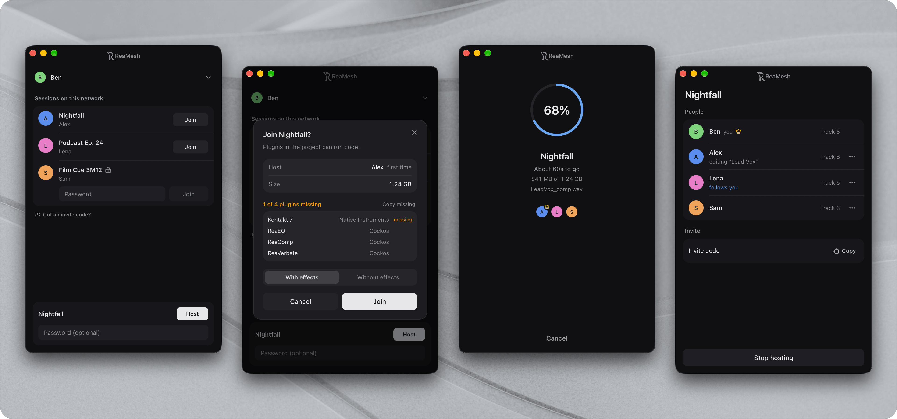
</picture>

### What stays in sync

Edits reach the others in about a second.

| Part of the project | Shared edits |
| --- | --- |
| Tracks | Add, remove, reorder, names, volume, pan, colors, folders and lane settings |
| Audio and MIDI items | Move, split, trim, fades, takes, take FX and MIDI content |
| Effects and automation | Track FX, input FX, plug-in state and track envelopes |
| Routing and groups | Sends, receives, send envelopes and group/VCA assignments |
| Project settings | Tempo, time signatures, markers, regions, notes, title, author and timebase |
| Media files | New recordings and imported files transfer in the background |

Track mute, solo, record arm, monitoring and window layout stay yours. The master
track, hardware outputs, pooled automation items, marker ruler lanes and project
extension state aren't synced.

### Work on the same project without conflicts

Whoever edits something first holds it until two seconds after their last change.
If someone else changes it in that time, their edit snaps back and they see who is
working on it. This applies to the host as well. Items others are editing turn grey
on your screen.

Other people's edits don't add undo points, so Ctrl+Z (Cmd+Z on macOS) starts with
your own work. REAPER's undo restores whole snapshots though, so undoing an earlier
action can roll back changes you received, and that rollback syncs too.

<picture>
  <source media="(prefers-color-scheme: dark)" srcset="proprietary/changelog/1.0.0-editing-lock-dark.png">
  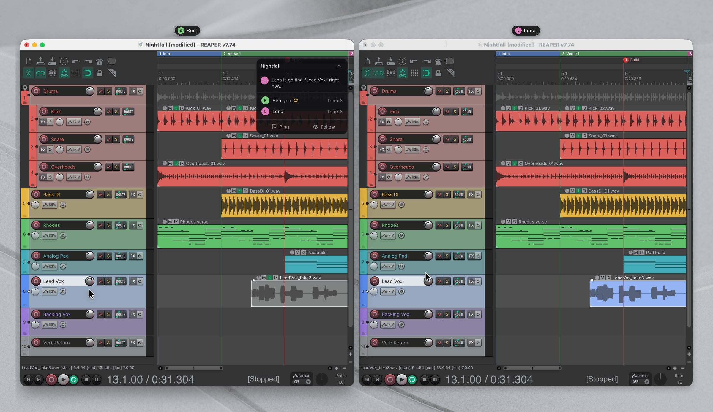
</picture>

### See who is there

- A small floating list over REAPER shows who is connected and which track they
  are on.
- Follow someone to keep up with their playback, selected track, view, item
  selection and open effect window.
- Ping a spot on the timeline. Everyone can jump to it or turn it into a marker.
- Hosts can remove a guest, or block their device for 30 minutes.
- If the host's computer drops out, guests reconnect on their own when the session
  comes back.

### Private by choice

- Add a passphrase to a session and only people who know it can download, edit or
  appear in the session. Session messages are then encrypted too. Session names stay
  visible on the network, and open sessions don't have this extra encryption.
- Only join people you trust: a shared project can load plug-ins on your computer.
  ReaMesh asks before you join, and checks the downloaded project for plug-ins the
  host didn't list before opening it.

### The ReaMesh app

- The app installs the REAPER extension for you. You need REAPER 7.12 or later.
- macOS 11 or later (Apple silicon and Intel) and 64-bit Windows.
- English and German.
- Updates download in the background and install when you restart the app, from the
  Stable or Beta channel.

Backgrounds by Pawel Czerwinski and Andrew Kliatskyi on Unsplash.
