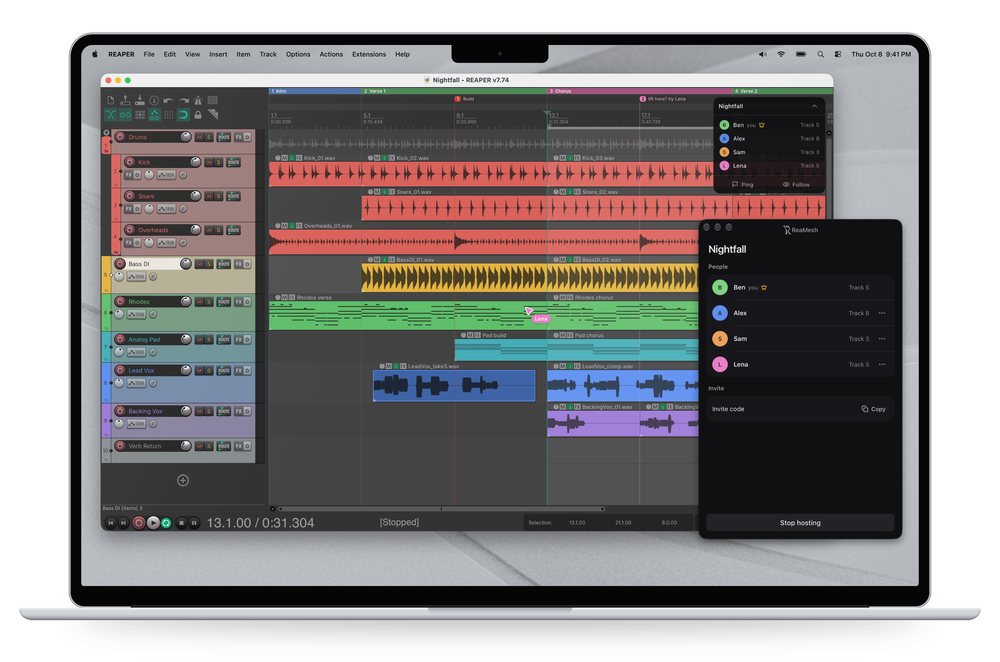
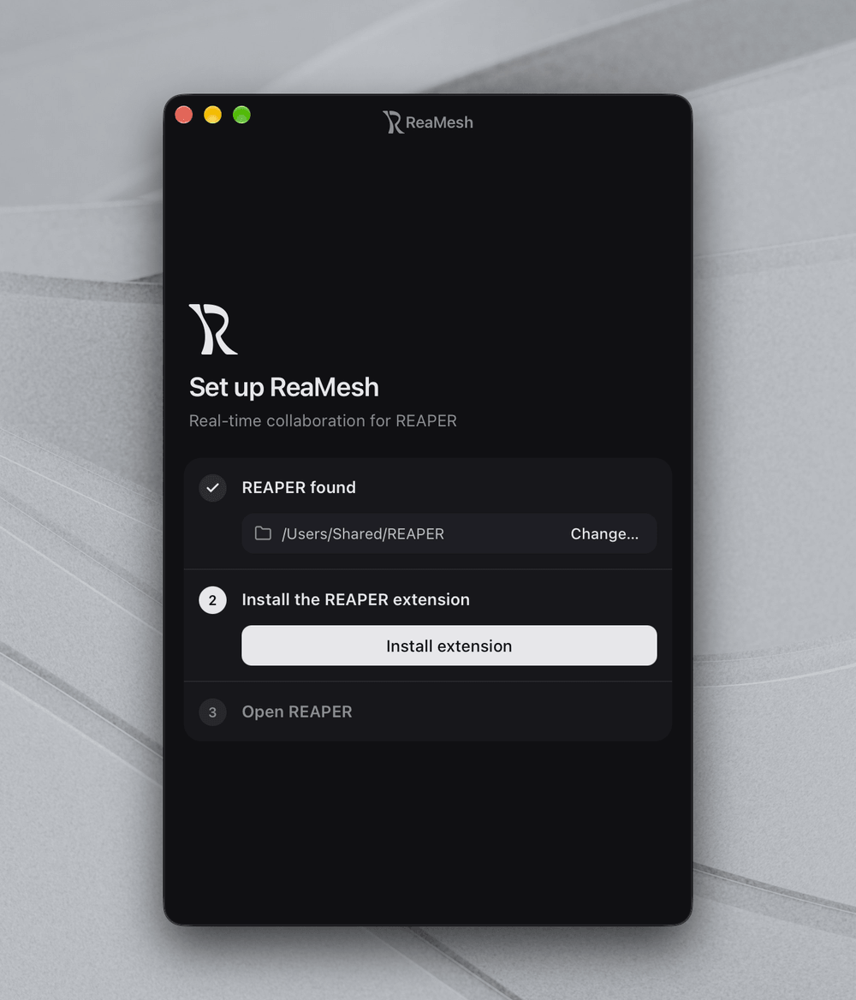
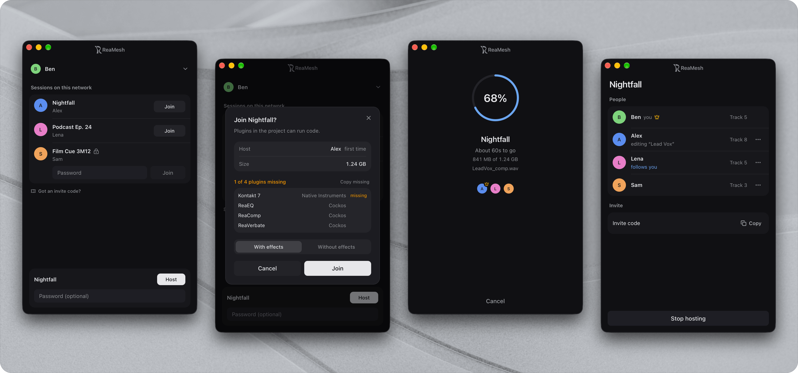
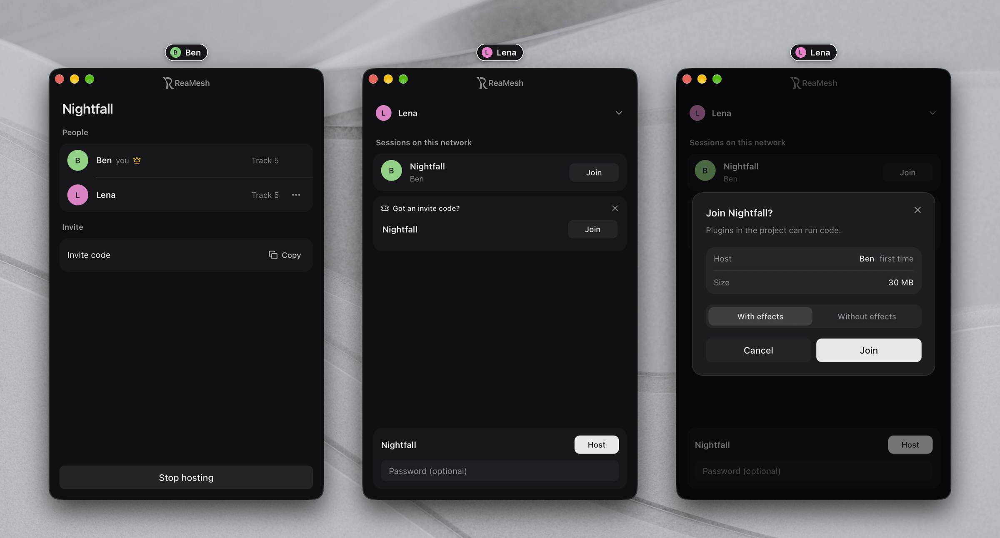
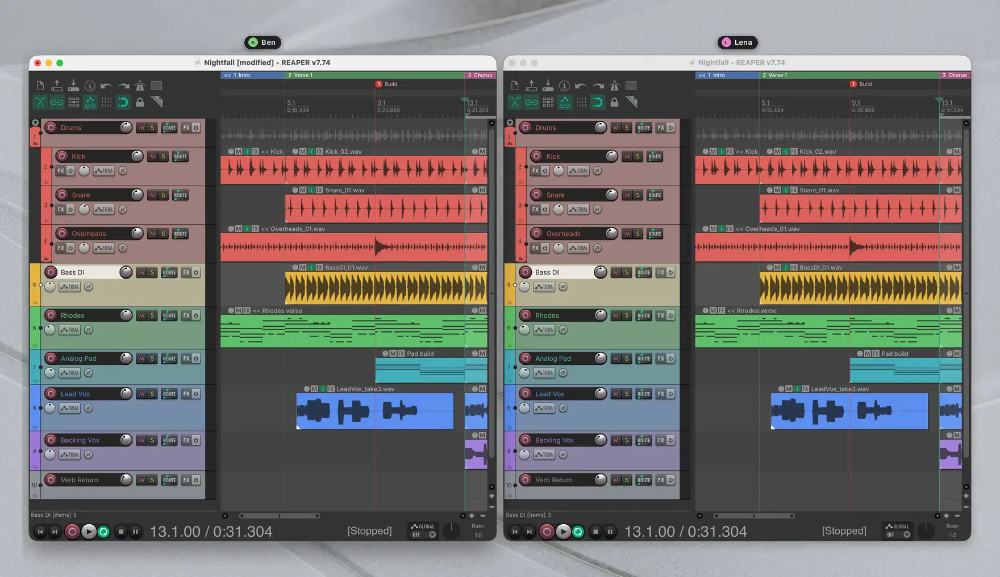
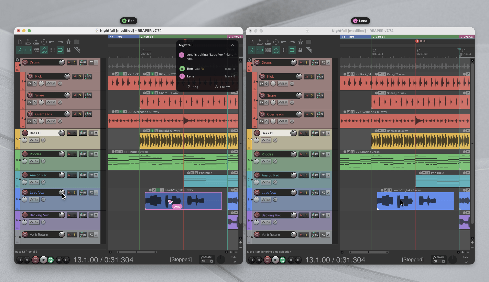

<h1><picture><source media="(prefers-color-scheme: dark)" srcset="proprietary/logo/lockup-dark.png"></picture></h1>

<a href="https://github.com/ReaMesh/ReaMesh/releases/latest"><picture><source media="(prefers-color-scheme: dark)" srcset="https://shieldcn.dev/github/release/ReaMesh/ReaMesh.svg?label=Release&amp;color=3f3f46&amp;logo=ri%3AGoTag&amp;variant=outline&amp;mode=dark&amp;valueColor=f0f6fc&amp;labelTextColor=f0f6fc&amp;logoColor=f0f6fc&amp;labelOpacity=1"></picture></a>
<a href="https://github.com/ReaMesh/ReaMesh/releases"><picture><source media="(prefers-color-scheme: dark)" srcset="https://shieldcn.dev/badge/dynamic/json.svg?url=https%3A%2F%2Fgithub.com%2FReaMesh%2FReaMesh%2Freleases%2Fdownload%2Fupdater%2Fdownloads.json&amp;query=%24.downloads&amp;variant=outline&amp;label=Downloads&amp;color=3f3f46&amp;logo=ri%3AGoDownload&amp;mode=dark&amp;valueColor=f0f6fc&amp;labelTextColor=f0f6fc&amp;logoColor=f0f6fc&amp;labelOpacity=1"></picture></a>
<picture><source media="(prefers-color-scheme: dark)" srcset="docs/badges/platforms-dark.svg"></picture>
<picture><source media="(prefers-color-scheme: dark)" srcset="https://shieldcn.dev/badge/REAPER-7.12%2B-3f3f46.svg?logo=ri%3ALuAudioWaveform&amp;variant=outline&amp;mode=dark&amp;valueColor=f0f6fc&amp;labelTextColor=f0f6fc&amp;logoColor=f0f6fc&amp;labelOpacity=1"></picture>
<a href="LICENSE"><picture><source media="(prefers-color-scheme: dark)" srcset="https://shieldcn.dev/badge/License-GPL--3.0--only-3f3f46.svg?variant=outline&amp;logo=ri%3AGoLaw&amp;mode=dark&amp;valueColor=f0f6fc&amp;labelTextColor=f0f6fc&amp;logoColor=f0f6fc&amp;labelOpacity=1"></picture></a>

Work on a REAPER project together. ReaMesh shares project files and keeps edits
in sync between computers on a local network or VPN. No account or server needed.

One person hosts a project, the others join and get a local copy. Everyone can
then edit tracks, arrange audio and MIDI, and work on effects. A desktop app
handles sessions, invitations and setup alongside REAPER.

<picture>
  <source media="(prefers-color-scheme: dark)" srcset="proprietary/screenshots/hero-dark.png">
  
</picture>

## Getting started

You'll need REAPER 7.12 or newer and the ReaMesh app on each computer. See
[Releases](https://github.com/ReaMesh/ReaMesh/releases) for packaged builds, or
[build from source](#building-from-source).

1. Open ReaMesh and follow the setup to install its bundled REAPER extension.
   If your REAPER resource folder isn't found, select it manually.

   <picture>
     <source media="(prefers-color-scheme: dark)" srcset="proprietary/screenshots/setup-dark.png">
     
   </picture>

2. Restart (or open) REAPER so it loads the extension. ReaMesh connects
   automatically.
3. Save a project in its own folder, then host it from the app. You can set a
   passphrase when creating the session.
4. On the other computer, join from the lobby, open the host's invite link or
   paste it in the lobby. ReaMesh downloads the project and opens it in REAPER.

<picture>
  <source media="(prefers-color-scheme: dark)" srcset="proprietary/screenshots/screens-dark.png">
  
</picture>

Everyone needs a compatible ReaMesh version. Sessions hosted with an
incompatible one are greyed out in the lobby.

**Hosting shares only the files the project uses**: the project file, the media
its items play, files that plugin state points to (a sampler's samples, an
impulse response) and sub-projects. Other files in the folder stay private.
Media items that point outside the project folder are copied into it so they
can be shared; files a plugin loads from outside the folder aren't shared.
Dotfiles, `.rpp-bak` backups and `.reapeaks` caches are never sent.

Sessions are discovered automatically on the LAN. For a VPN or a network where
discovery doesn't work, use an invite code. Both computers still need a direct
network route to each other; ReaMesh has no relay or NAT traversal. An invite
code is valid only while that hosting session is running.

<picture>
  <source media="(prefers-color-scheme: dark)" srcset="proprietary/screenshots/invite-dark.png">
  
</picture>

<sub>Backgrounds by Pawel Czerwinski and Andrew Kliatskyi on Unsplash.</sub>

## What syncs

<picture>
  <source media="(prefers-color-scheme: dark)" srcset="proprietary/screenshots/live-sync-dark.webp">
  
</picture>

| Part of the project | Shared edits |
| --- | --- |
| Tracks | Add, remove, reorder, names, volume, pan, colors, folders and lane settings |
| Audio and MIDI items | Move, split, trim, fades, takes, take FX and MIDI content |
| Effects and automation | Track FX, input FX, plugin state and track envelopes |
| Routing and groups | Sends, receives, send envelopes and group/VCA assignments |
| Project settings | Tempo, time signatures, markers, regions, notes, title, author and timebase |
| Media files | New recordings and imported files transfer in the background |

Track mute, solo, record arm, monitoring and window layout stay local. Item mute
does sync. Master-track state, hardware outputs, pooled automation items, marker
ruler lanes and project extension state aren't synced.

An optional floating roster shows who's connected. You can follow someone's
playback, selected track, view, item selection and open effect window, or ping
a spot on the timeline that everyone can jump to. Hosts can remove guests or block their device for 30
minutes.

Everyone's mouse pointer appears right in REAPER's arrange view,
on the same spot of the song whatever each person's zoom and scroll. While
someone drags items you see where they will land, their faders and plugin
knobs move as they turn them, and while they work in the mixer, an effect
window or the MIDI editor their pointer waits beside that track or item. Showing
other people's pointers and sharing your own are both settings.

## Working together

Whoever edits a field first holds it until two seconds after their last change.
Competing edits snap back, including the host's. Whole items, FX chains and sets
of track envelopes each count as one field, so working on different tracks or
items avoids conflicts. An item someone else is editing is dimmed with an
outline in their color (point at it to see who), and an edit of yours that
snaps back glides back into place.

<picture>
  <source media="(prefers-color-scheme: dark)" srcset="proprietary/screenshots/edit-lock-dark.png">
  
</picture>

Remote edits don't create undo points. Undoing an earlier local action can still
roll back received changes because REAPER uses snapshots for undo. That rollback
syncs too.

Large projects can open while media is still downloading. Missing items appear
as placeholders, and the project stays view-only until loading finishes. When
the host stops the session, everyone keeps their local project copy.

To use the project's effects, you'll need the plugins installed locally. The
join preview checks for them in REAPER's plugin caches. You can also join without
effects in view-only mode.

Only join people you trust: shared projects can load plugins on your computer.
Passphrase-protected sessions restrict downloading and editing and encrypt
session messages. Session names remain public for discovery. Open sessions
don't have this extra message encryption.

## Building from source

Install Rust, Bun, CMake 3.20 or newer, and the
[Tauri system dependencies](https://v2.tauri.app/start/prerequisites/) for your
platform. On Windows, use the MSVC toolchain and run the script from Git Bash.
On macOS, install the Xcode command-line tools.

The macOS config includes the maintainer's signing identity. Before a local
build, set `bundle.macOS.signingIdentity` in
[`app/src-tauri/tauri.conf.json`](app/src-tauri/tauri.conf.json) to your own
identity, or `"-"` for [ad-hoc signing](https://v2.tauri.app/distribute/sign/macos/#ad-hoc-signing).

From the repository root:

```sh
./build.sh
```

This builds the Rust core, REAPER extension and ReaMesh app. `cbindgen` is
optional; without it, the build uses the checked-in FFI header.

| Output | Location |
| --- | --- |
| Windows installer | `app/src-tauri/target/release/bundle/nsis/` |
| macOS app | `app/src-tauri/target/release/bundle/macos/ReaMesh.app` |
| Windows extension | `extension/build/Release/reaper_reamesh.dll` |
| macOS extension | `extension/build/reaper_reamesh.dylib` |

After building the extension, run the app in development mode:

```sh
cd app
bun install
bun run tauri dev
```

REAPER must be running with the extension installed for live session data.
The app uses Bun for package management.

### Checks

Run these from the repository root:

```sh
cargo test --manifest-path rust/Cargo.toml -- --test-threads=1
cd app
bun install
bun run build
bun run test
```

Rust session tests use real sockets and must run serially. There are also
[C ABI smoke tests](tools/ffi_smoke.cpp) and
[state-chunk tests](tools/chunk_test.cpp).

## Code layout

- [`extension/`](extension/): C++ extension that reads and applies REAPER state
  on its main thread.
- [`rust/`](rust/): networking, file transfers and shared state using libp2p,
  Tokio and yrs. The host coordinates edits and editing locks.
- [`app/`](app/): the ReaMesh desktop app, built with Tauri 2, React and shadcn/ui.

The extension and Rust core communicate through a C ABI. The ReaMesh app
talks to the extension over a localhost WebSocket.

## Contributing

Bug reports and pull requests are welcome. For larger changes, open an issue
first so we can discuss the approach. See [CONTRIBUTING.md](CONTRIBUTING.md)
for development guidelines.
Report security issues privately using the process in [SECURITY.md](SECURITY.md).

## License and trademark

ReaMesh is licensed under [GPL-3.0-only](LICENSE). Third-party licenses are
listed in [THIRD_PARTY.md](THIRD_PARTY.md).

The ReaMesh name and logo aren't covered by the GPL. Modified versions must use
a different name and logo and must not present themselves as the ReaMesh project.
References such as "based on ReaMesh" are fine.
The logo, icons, installer artwork and screenshots are kept in [`proprietary/`](proprietary/).

REAPER is a trademark of Cockos Incorporated. ReaMesh is not affiliated with Cockos.
