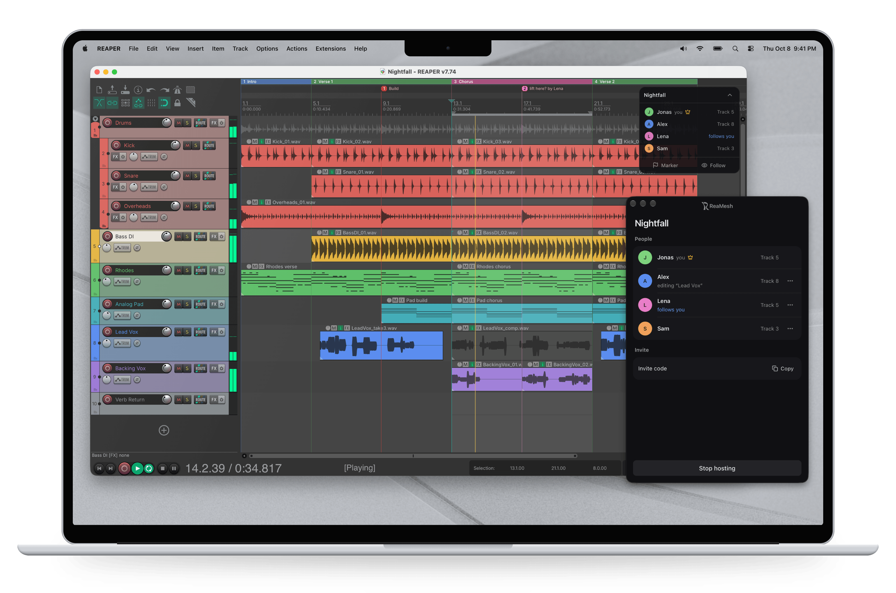
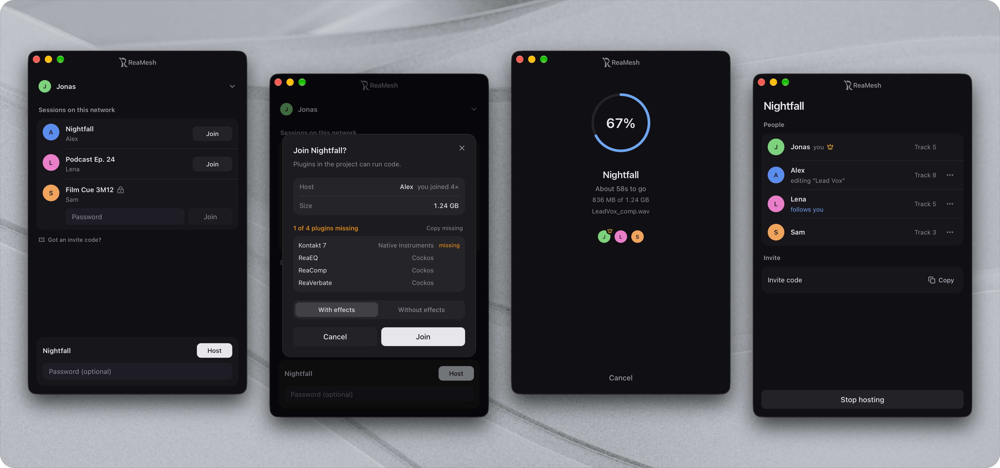

<h1><picture><source media="(prefers-color-scheme: dark)" srcset="docs/logo/lockup-dark.png"></picture></h1>

<a href="LICENSE"><picture><source media="(prefers-color-scheme: dark)" srcset="https://shieldcn.dev/badge/License-GPL--3.0--only-3f3f46.svg?variant=outline&amp;logo=ri%3AGoLaw&amp;mode=dark&amp;valueColor=f0f6fc&amp;labelTextColor=f0f6fc&amp;logoColor=f0f6fc&amp;labelOpacity=1"></picture></a>
<picture><source media="(prefers-color-scheme: dark)" srcset="docs/badges/platforms-dark.svg"></picture>
<a href="app/"><picture><source media="(prefers-color-scheme: dark)" srcset="https://shieldcn.dev/badge/Tauri-v2-3f3f46.svg?variant=outline&amp;logo=tauri&amp;mode=dark&amp;valueColor=f0f6fc&amp;labelTextColor=f0f6fc&amp;logoColor=f0f6fc&amp;labelOpacity=1"></picture></a>

Work on a REAPER project together. ReaMesh shares project files and keeps edits
in sync between computers on a local network or VPN. No account or server needed.

One person hosts a project, the others join and get a local copy. Everyone can
then edit tracks, arrange audio and MIDI, and work on effects. A desktop app
handles sessions, invitations and setup alongside REAPER.

<picture>
  <source media="(prefers-color-scheme: dark)" srcset="docs/screenshots/hero-dark.png">
  
</picture>

## Getting started

You'll need REAPER and the ReaMesh app on each computer. See
[Releases](https://github.com/ReaMesh/ReaMesh/releases) for packaged builds, or
[build from source](#building-from-source).

1. Open ReaMesh and follow the setup to install its bundled REAPER extension.
   If your REAPER resource folder isn't found, select it manually.
2. Restart REAPER so it loads the extension. ReaMesh connects automatically.
3. Save a project in its own folder, then host it from the app. You can set a
   passphrase when creating the session.
4. On the other computer, join from the lobby or paste the host's invite code.
   ReaMesh downloads the project and opens it in REAPER.

**Hosting shares the project folder**, including files that aren't used in the
project. Dotfiles, `.rpp-bak` backups and `.reapeaks` caches are excluded.
Referenced media outside the folder is copied into it for sharing.

Sessions are discovered automatically on the LAN. For a VPN or a network where
discovery doesn't work, use an invite code. Both computers still need a direct
network route to each other; ReaMesh has no relay or NAT traversal. An invite
code is valid only while that hosting session is running.

<picture>
  <source media="(prefers-color-scheme: dark)" srcset="docs/screenshots/screens-dark.png">
  
</picture>

<sub>Backgrounds by Pawel Czerwinski and Andrew Kliatskyi on Unsplash.</sub>

## What syncs

| Part of the project | Shared edits |
| --- | --- |
| Tracks | Add, remove, reorder, names, volume, pan, colors, folders and lane settings |
| Audio and MIDI items | Move, split, trim, fades, takes, take FX and MIDI content |
| Effects and automation | Track FX, input FX, plugin state and track envelopes |
| Routing and groups | Sends, receives, send envelopes and group/VCA assignments |
| Project settings | Tempo, time signatures, markers, regions, notes, title, author and timebase |
| Media files | New recordings and imported files transfer in the background |

Track mute, solo, record arm, monitoring and window layout stay local. Item mute
does sync. Master-track state, hardware outputs, pooled automation items, marker
ruler lanes and project extension state aren't synced.

An optional floating roster shows who's connected. You can follow someone's
playback and track focus or share a marker at your cursor. Hosts can remove
guests or block their peer identity for 30 minutes.

## Working together

Whoever edits a field first holds it until two seconds after their last change.
Competing edits snap back, including the host's. Whole items, FX chains and sets
of track envelopes each count as one field, so working on different tracks or
items avoids conflicts.

Remote edits don't create undo points. Undoing an earlier local action can still
roll back received changes because REAPER uses snapshots for undo. That rollback
syncs too.

Large projects can open while media is still downloading. Missing items appear
as placeholders, and the project stays view-only until loading finishes. When
the host stops the session, everyone keeps their local project copy.

To use the project's effects, you'll need the plugins installed locally. The
join preview checks for them in REAPER's plugin caches. You can also join without
effects in view-only mode.

Only join people you trust: shared projects can load plugins on your computer.
Passphrase-protected sessions restrict downloading and editing and encrypt
session messages. Session names remain public for discovery. Open sessions
don't have this extra message encryption.

## Building from source

Install Rust, Bun, CMake 3.20 or newer, and the
[Tauri system dependencies](https://v2.tauri.app/start/prerequisites/) for your
platform. On Windows, use the MSVC toolchain and run the script from Git Bash.
On macOS, install the Xcode command-line tools.

The macOS config includes the maintainer's signing identity. Before a local
build, set `bundle.macOS.signingIdentity` in
[`app/src-tauri/tauri.conf.json`](app/src-tauri/tauri.conf.json) to your own
identity, or `"-"` for [ad-hoc signing](https://v2.tauri.app/distribute/sign/macos/#ad-hoc-signing).

From the repository root:

```sh
./build.sh
```

This builds the Rust core, REAPER extension and companion app. `cbindgen` is
optional; without it, the build uses the checked-in FFI header.

| Output | Location |
| --- | --- |
| Windows installer | `app/src-tauri/target/release/bundle/nsis/` |
| macOS app | `app/src-tauri/target/release/bundle/macos/ReaMesh.app` |
| Windows extension | `extension/build/Release/reaper_reamesh.dll` |
| macOS extension | `extension/build/reaper_reamesh.dylib` |

After building the extension, run the app in development mode:

```sh
cd app
bun install
bun run tauri dev
```

REAPER must be running with the extension installed for live session data.
The app uses Bun for package management.

### Checks

Run these from the repository root:

```sh
cargo test --manifest-path rust/Cargo.toml -- --test-threads=1
cd app
bun install
bun run build
bun run test
```

Rust session tests use real sockets and must run serially. There are also
[C ABI smoke tests](tools/ffi_smoke.cpp) and
[state-chunk tests](tools/chunk_test.cpp).

## Code layout

- [`extension/`](extension/): C++ extension that reads and applies REAPER state
  on its main thread.
- [`rust/`](rust/): networking, file transfers and shared state using libp2p,
  Tokio and yrs. The host coordinates edits and editing locks.
- [`app/`](app/): desktop companion built with Tauri 2, React and shadcn/ui.

The extension and Rust core communicate through a C ABI. The companion app
talks to the extension over a localhost WebSocket.

## Contributing

Bug reports and pull requests are welcome. For larger changes, open an issue
first so we can discuss the approach. See [CONTRIBUTING.md](CONTRIBUTING.md)
for development guidelines.
Report security issues privately using the process in [SECURITY.md](SECURITY.md).

## License and trademark

ReaMesh is licensed under [GPL-3.0-only](LICENSE). Third-party licenses are
listed in [THIRD_PARTY.md](THIRD_PARTY.md).

The ReaMesh name and logo aren't covered by the GPL. Modified versions must use
a different name and logo and must not present themselves as the ReaMesh project.
References such as "based on ReaMesh" are fine.

REAPER is a trademark of Cockos Incorporated. ReaMesh is not affiliated with Cockos.
